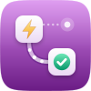
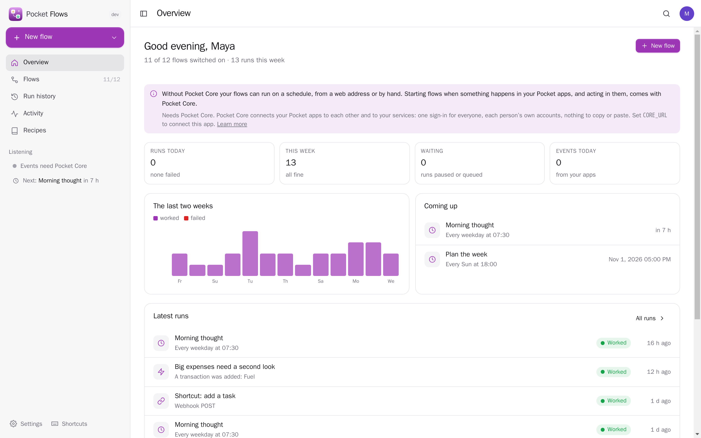
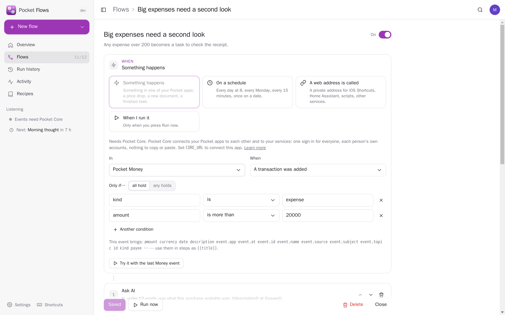
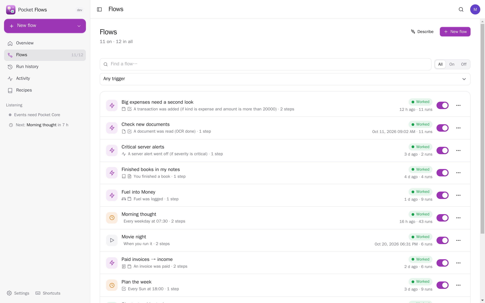
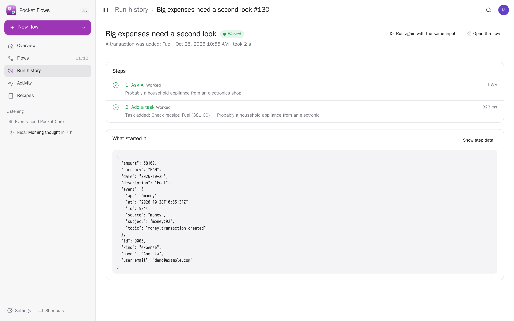
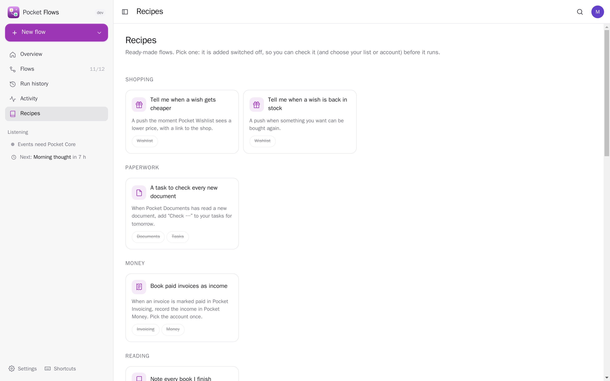
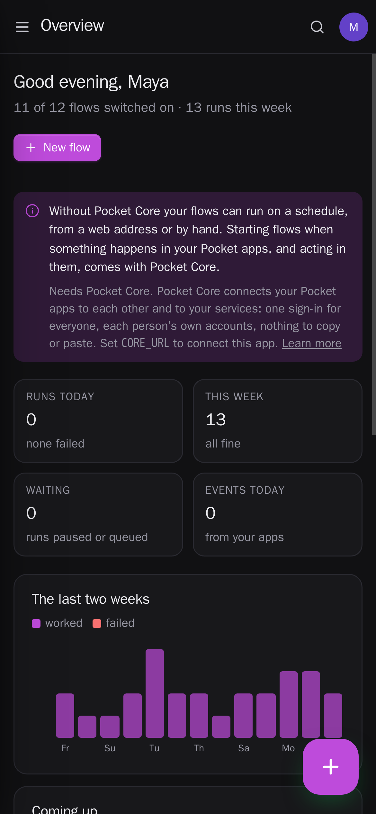
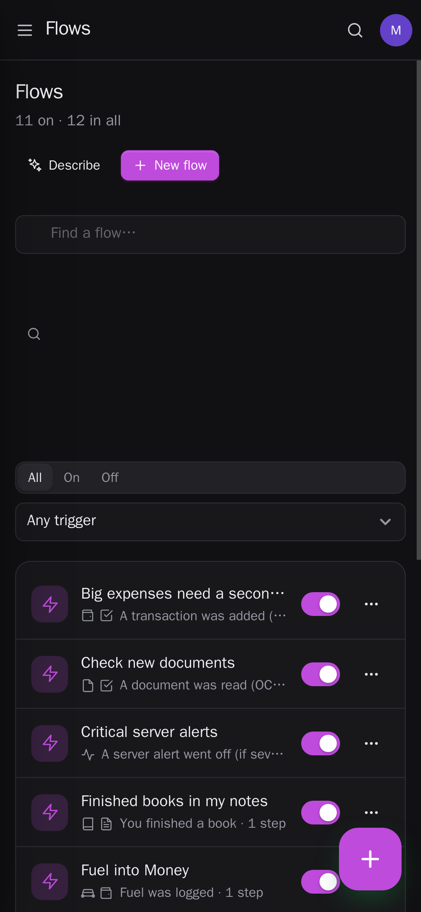
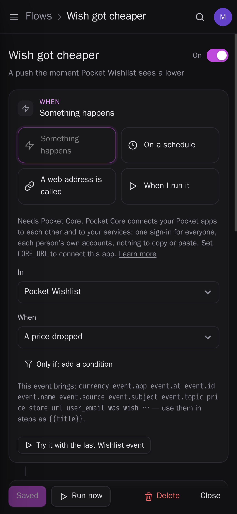

<p align="center"></p>
<h1 align="center">Pocket Flows</h1>
<p align="center">Automations for your own server. When something happens — a price drops on your wishlist, a document arrives, a task is done, a time of day, a webhook from iOS Shortcuts or Home Assistant — Flows does things for you: sends a push, adds a task, a note, a calendar event or a transaction, calls a web address, asks AI. Build a flow step by step, start from a recipe, describe it in your own words, or bring your n8n workflows along. Every run is kept with what each step did, failed steps are retried, and you hear about it when something breaks.<br>One Go binary, one SQLite file, one volume. Part of the Pocket apps; works on its own too.</p>
<p align="center">
  <a href="https://github.com/abjelosevic88/pocket-homelab-flows/actions"></a>
  <a href="https://github.com/abjelosevic88/pocket-homelab-flows/pkgs/container/pocket-homelab-flows"></a>
  <a href="LICENSE"></a>
</p>

---

<p align="center"></p>

<table>
  <tr>
    <td width="50%"></td>
    <td width="50%"></td>
  </tr>
  <tr>
    <td align="center"><sub>When this happens, then these steps — with conditions, placeholders from the trigger and earlier steps, and a test run.</sub></td>
    <td align="center"><sub>Every flow with its switch, the apps it touches and how its last run went.</sub></td>
  </tr>
  <tr>
    <td width="50%"></td>
    <td width="50%"></td>
  </tr>
  <tr>
    <td align="center"><sub>Each run with what each step did and how long it took; try a failed run again from the step that failed.</sub></td>
    <td align="center"><sub>Recipes: price drops, paid invoices, new documents, server alerts, a task from anywhere.</sub></td>
  </tr>
</table>

<p align="center">
  &nbsp;&nbsp;
  &nbsp;&nbsp;
  
</p>

## What it does

- **Triggers**: something happens in one of your Pocket apps (about 140 events from 35 apps: a price drop, a new document, a paid invoice, a finished book, a task reminder, a server alert…), a schedule (every N minutes, hourly, daily, on weekdays you pick, monthly, once), a private webhook address, or by hand. Conditions on any field (“only if the price is under 100”).
- **Steps**: send me a notification (Apprise, ntfy or a webhook), call a web address (its answer is usable later), ask AI, wait (minutes to days, survives restarts), only continue if…; and in your Pocket apps: add a task, add a line to today's note, create a note, add a calendar event, record a transaction, tick a habit, change a stock count, create an issue. Every step can be skipped by a condition or allowed to fail.
- **Placeholders**: `{{title}}`, `{{steps.s1.text}}`, `{{price | cents}}`, `{{today}}` — picked from a list of what the trigger and earlier steps actually give.
- **Recipes and AI**: sixteen ready-made flows, added switched off so you can check them; or describe a flow in a sentence and AI drafts it.
- **Runs**: durable — a restart or a 30-day wait picks up where it was; steps that fail for a reason that may pass are retried after 1, 5 and 20 minutes; a push when a flow fails and when it works again; run history with each step's output, retry from the failed step, CSV export.
- **Activity**: what your apps told Flows in the last 30 days, and a flow made from any of it in one click.
- **Coming from n8n**: import workflow exports; schedules, webhooks, HTTP requests, waits and notifications carry over, the rest is listed.
- **Everyone their own**: each person has their own flows, runs, events and connections; admins see no one else's. Members' web steps cannot reach the local network unless an admin allows it.

## Run it

```sh
docker run -d --name pocket-flows -p 8080:8080 -v ./data:/data \
  -e BASE_URL=https://flows.example.com -e SECURE_COOKIES=true \
  ghcr.io/abjelosevic88/pocket-homelab-flows:latest
```

or `docker compose up -d` with [docker-compose.yml](docker-compose.yml). Open it, create the first account and make your first flow. All options: [docs/configuration.md](docs/configuration.md). API: [docs/api.md](docs/api.md).

## With Pocket Core

Set `CORE_URL` and `CORE_REGISTRATION_KEY` and Flows joins the box: people sign in with Pocket Core, Flows hears each person's events from their Pocket apps (an `events:read` link per app — only events that belong to that person) and acts in their apps as them through app links, with nothing to paste. “Ask AI” uses Pocket AI. Other Pocket apps can read your flows and runs (`flows:read`) or start a flow that runs by hand (`flows:run`). Events on the bus: `flows.run_finished`, `flows.run_failed`, `flows.flow_created`. Without Core, flows run on schedules, webhooks and by hand, and every app connection can be made directly with a URL and a token; the Core-only choices stay visible, greyed out.

## Develop

```sh
make dev     # API on :8080 with demo data + Vite on :5173
make test    # go vet, go test, tsc
make         # web + binary
```

MIT licensed.
